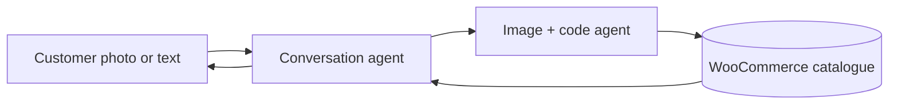

# A Store Assistant That Reads Product Codes From Photos

Customers send a screenshot and ask "do you have this?". The bot finds the product code in the image and answers from the live catalogue.

> **Case study.** Source code is private. The business problem, the design decisions and the stack are documented here.

## The problem

Shoppers rarely type product names. They send photos and screenshots, and a human had to open each one, find the code and check the shop. That does not scale past a handful of chats a day.

## What was built

- **Two cooperating agents**: one for conversation, one for image and code handling
- **Product code extraction** from customer images
- **WooCommerce integration** for live product and order data
- **Order handling** driven by the extracted code

## How it fits together

## Stack

Conversational AI platform · Vision-capable LLM · WooCommerce API

## Status

Delivered for an online gallery store.

---

Questions about the build, or a similar system for your business? **info@hamedsamii.com**
